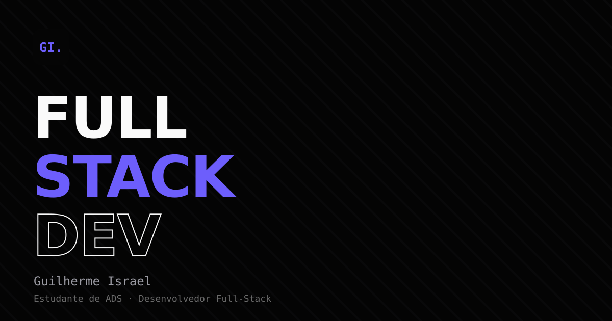

# Guilherme Israel — Portfólio

Portfólio pessoal em página única, construído em React + Vite. Estética dark, minimalista, com um único acento roxo e navegação por clique (sem router).



🔗 **[Ver online](#)** _(atualize com a URL depois do deploy)_

## Sobre

Site pessoal de Guilherme Israel, desenvolvedor full-stack e estudante de Análise e Desenvolvimento de Sistemas. Reúne apresentação, stack, formação e os projetos em destaque, cada um com página de detalhe própria (sobre, destaques, vídeo e prints).

## Stack

- [React 19](https://react.dev/)
- [Vite](https://vitejs.dev/)
- CSS puro (custom properties, nesting nativo, sem framework de UI)

## Rodando localmente

```bash
npm install
npm run dev
```

Build de produção:

```bash
npm run build
npm run preview
```

## Estrutura

```
src/
  components/   # Nav, Hero, About, Education, Projects, ProjectDetail, Contact
  data/         # content.js — todo o conteúdo do site (textos, projetos, links)
  App.jsx       # estado de navegação (home ↔ detalhe do projeto)
public/
  projects/<slug>/  # vídeo + prints de cada projeto
```

Editar textos, stack, projetos ou links de contato é feito em um único lugar: [`src/data/content.js`](src/data/content.js).

## Contato

- E-mail: guilhermeisrael03@gmail.com
- GitHub: [github.com/Guilherme3578](https://github.com/Guilherme3578)
- LinkedIn: [linkedin.com/in/guilhermeisrael](https://linkedin.com/in/guilhermeisrael/)
